# Combat Flowchart

[[General Index|General index]] · [[Core Rules Index#Combat and modifiers|Combat and modifiers]] · [[Showdown Flowchart|Related flowchart]]

The chart follows combat from its explicit start conditions through Showdown, damage, Special Cleanup, results, control, and combat ending. The Resolution panels are subdivisions of the official third step. Use [[Showdown Flowchart#Showdown loop|the showdown loop]] at the Showdown box.

**⚡** marks a satisfied trigger condition: the ability becomes Pending. **▶** marks chain processing after outstanding Tasks are handled. **🧹** marks queued Cleanup checkpoints; the **Combat Special Cleanup** is highlighted separately.

## Combat sequence

```mermaid
flowchart TD
    START["COMBAT START CONDITIONS<br/>During 🧹 Cleanup: combat staged at a Contested Battlefield<br/>Units of two opposing players; Chain empty<br/>No Showdown / Combat at another Battlefield<br/>Neutral Open, or Showdown Open here<br/>If several combats are staged, Turn Player chooses"]

    subgraph STEP1["1 · Combat Showdown"]
        A["Combat opens<br/>⚡ START OF COMBAT<br/>⚡ START OF SHOWDOWN only if newly opened"]
        B["Assign Attacker / Defender<br/>Assault / Shield apply immediately<br/>⚡ ATTACK / DEFEND at first designation this combat"]
        QUEUE["ADD Attack / Defend triggers to Combat Chain<br/>Attacker FIRST → other players, if any → Defender LAST<br/>Each player chooses their own triggers' order"]
        C["🧹 Queued Cleanups<br/>▶ Resolve newest Chain item first<br/>Defender's last-added trigger first,<br/>unless newer items are added"]
        D["Showdown loop<br/>All players pass Focus in sequence → close showdown"]
        A --> B --> QUEUE --> C --> D
    end

    subgraph STEP2["2 · Combat Damage"]
        E{"Both sides still have Units here?"}
        F["Assign damage using current Might<br/>Attacker first, then Defender"]
        G["Deal damage simultaneously<br/>⚡ DEAL / TAKE DAMAGE triggers NOW"]
        E -->|Yes| F --> G
    end

    subgraph CLEANUP["3 · Resolution — Special Cleanup"]
        H[["🧹 COMBAT SPECIAL CLEANUP<br/>⚡ Death / leaving / movement triggers<br/>at the corresponding events INSIDE this cleanup"]]
        I["🧹 Queued normal Cleanups<br/>▶ Process damage / cleanup chains"]
        H --> I
    end

    subgraph RESULTS["3 · Resolution — Results"]
        J["Determine combat result<br/>⚡ WIN / LOSE COMBAT when result is assigned<br/>No Result + both remain → stage new Showdown / Combat"]
        K["🧹 Cleanup checkpoints<br/>▶ Process result chains"]
        J --> K
    end

    subgraph CONTROL["3 · Resolution — Control"]
        L["If no Showdown / Combat is staged here: establish Control<br/>⚡ CONQUER here, if eligible to score"]
        M["🧹 Cleanup checkpoints<br/>▶ Process control / Conquer chains"]
        L --> M
    end

    subgraph END["3 · Resolution — Combat Ends"]
        N["Combat ends; remove Attacker / Defender<br/>Assault / Shield stop applying<br/>⚡ END OF COMBAT triggers NOW<br/>Then expire 'this combat' effects"]
        O["🧹 Cleanup checkpoints<br/>▶ Process end-of-combat chains<br/>Resume play / next staged window"]
        N --> O
    end

    START --> A
    D --> E
    E -->|No: skip damage| H
    G -->|No chain processing before Special Cleanup| H
    I --> J
    K --> L
    M --> N
```

Damage triggers become Pending before Combat Special Cleanup, but their chains are processed after it. If Cleanup converts an existing showdown to combat, keep the current Focus; start-of-showdown effects do not repeat.

## Keyword timing side notes

| Ability                 | When it applies                                                                                                                                                                       |     |
| ----------------------- | ------------------------------------------------------------------------------------------------------------------------------------------------------------------------------------- | --- |
| [[Assault]] X           | Passive: +X Might immediately while the Unit has Attacker designation. Stops when that designation is lost.                                                                           |     |
| [[Shield]] X            | Passive: +X Might immediately while the Unit has Defender designation. Stops when that designation is lost.                                                                           |     |
| [[Disarm]] X            | Attack trigger: queued at first Attacker designation. Its -X Might applies when the ability resolves, and lasts this turn.                                                            |     |
| [[Tank]] / [[Backline]] | Passive assignment rules in Combat Damage: Tank first, Backline last. They do not add triggers to the Chain.                                                                          |     |
| [[Stun]]                | Applies when the instruction executes. Contributes no Might to combat damage; keeps its Might for lethal checks. Clears in end-of-turn cleanup.                                       |     |
| [[Deathknell]]          | Queues just before a killed source enters Trash, after replacements. Combat-damage deaths: inside Special Cleanup; resolve afterward. Death replaced with Recall does not trigger it. |     |
| [[Deflect]] X           | While the passive is active, adds X Power per targeting by an enemy spell/ability; paid during playing, including in the showdown.                                                    |     |
| [[Hunt]] X              | Triggers on Conquer in the control step, not merely winning combat. Grants XP when it resolves. Also triggers on Hold outside combat.                                                 |     |
| [[Ambush]]              | Reaction permission when played to a Battlefield where you control Units. A joining Unit gains Attack/Defend designation during Cleanup.                                              |     |
| [[Quick-Draw]]          | Reaction permission. Its play trigger queues after the Gear enters the Board; attachment happens when that trigger resolves.                                                          |     |

For other simultaneous triggers: Turn Player first, then turn order; each player orders their own triggers. Newly joining Units gain their designation in Cleanup and can trigger Attack/Defend the first time they gain it that combat.

## Read the full rules

- [[Combat]]
- [[Combat Procedure]]
- [[Showdowns]]
- [[Cleanups]]
- [[Triggered Ability]]
- [[Handling Tasks and Resolving Chain Items]]
- [[Conquer]]
- [[Scoring]]

This chart is a reading aid. The linked rule notes contain the full conditions, exceptions, and procedures.

## Source references

ⓘ

Core rules 319, 320, 321, 322, 323, 334, 340, 383.2.c, 383.3.d, 383.4.e, 383.4.f, 462, 463, 466, 467, 468, 807, 808, 809, 814, 815, 819, 822, 823, 826, 831, 424; PDF pages 40, 41, 43, 44, 67, 69, 71, 84, 100, 101, 104, 127, 128, 132, 134, 137, 138, 141

