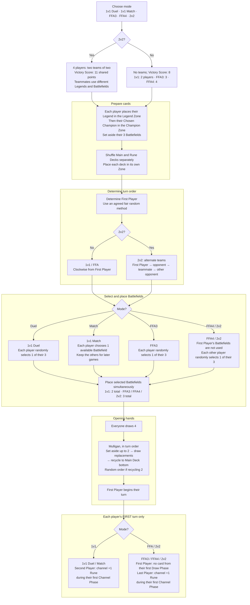

# Game Setup Flowchart

[[General Index|General index]] · [[Core Rules Index#Deck construction and setup|Core setup rules]] · [[Tournament Rules Index#Matches and tournament procedures|Tournament procedures]] · [[Turn Phases Flowchart|Turn sequence]]

All five Core Rules modes share one path until their setup procedures diverge. Battlefield selection is shown after determining the First Player because FFA4 and 2v2 depend on that result. See [[Game Setup Flowchart#Tournament adjustments|Tournament adjustments]] for competition-specific changes.

## Game setup sequence

## Between games of 1v1 Match

- [[1v1 (Match)|1v1 Match]] is best of 3 by default; optionally best of 5. Other modes are best of 1.
- After a won game, both players use different Battlefields next game.
- Best-of-5 games 4–5 permit reuse after all three were presented, with no Battlefield presented more than twice.

## Tournament adjustments

- The [[Play First Rule]] gives a designated player the first/last choice. Later games use the previous loser’s choice; draws retain the starting order.
- [[2v2 (Tournament)|Tournament 2v2]] uses the repeating order **Team 1 A → Team 2 A → Team 1 B → Team 2 B**; the deciding team chooses the starting position.
- Draws require the same Battlefields next game. Deck presentation, opponent shuffling, sideboarding and the optional altered best-of-1 sequence follow [[Start of Game Procedure]].

## Read the full rules

- [[Setup Process]]
- [[1v1 (Duel)]]
- [[1v1 (Match)]]
- [[FFA3 (Skirmish)]]
- [[FFA4 (War)]]
- [[2v2 (Magma Chamber)]]
- [[Recycle]]
- [[Start of Game Procedure]]
- [[Play First Rule]]
- [[2v2 (Tournament)]]
- [[Sideboard]]
- [[Shuffling]]

This chart is a reading aid. The linked rule notes contain the full conditions, exceptions, and procedures.

## Source references

ⓘ

Core rules 110, 111, 112, 113, 114, 115, 116, 117, 118, 417, 487, 488, 489, 490, 491; PDF pages 7, 8, 79, 111, 112, 113

ⓘ

Tournament rules 403, 406, 407, 603.7; PDF pages 8, 9, 10, 31

