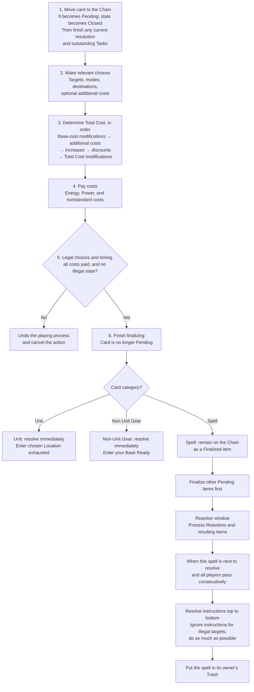

# Playing a Card Flowchart

[[General Index|General index]] · [[Core Rules Index#Playing cards and making choices|Playing cards and making choices]] · [[Playing or Activating Abilities Flowchart|Related flowchart]]

This chart summarizes the six stages of playing a card, followed by the different resolution paths for Units, Gear, and Spells.

## Playing a card

Units and Gear resolve immediately without a Reaction window between finalization and resolution. Their passive abilities become active, and their rules text is processed; any resulting triggered abilities follow their own process. See [[Trigger Timing Flowchart]] and [[Playing or Activating Abilities Flowchart]].

For costs, component-specific discounts apply when that component is added, before discounts on the total. Energy and Power costs cannot fall below zero.

## Read the full rules

- [[Playing Cards]]
- [[Process of Playing a Card]]
- [[Costs]]
- [[Targeting]]
- [[Unit]]
- [[Gear]]
- [[Spell]]
- [[Handling Tasks and Resolving Chain Items]]

This chart is a reading aid. The linked rule notes contain the full conditions, exceptions, and procedures.

## Source references

ⓘ

Core rules 334, 337, 340, 354, 355, 356, 357, 358, 359; PDF pages 43, 44, 46, 47, 52, 54, 55

