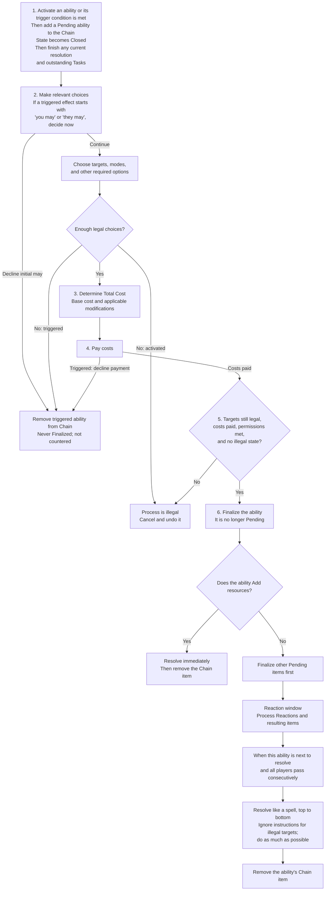

# Playing or Activating Abilities Flowchart

[[General Index|General index]] · [[Core Rules Index#Abilities and effects|Abilities and effects]] · [[Playing a Card Flowchart|Related flowchart]]

This chart summarizes the process for activated and triggered abilities. See [[Trigger Timing Flowchart]] for when trigger conditions are checked and [[Playing a Card Flowchart]] for the shared playing procedure.

## Playing or activating abilities

An activated ability’s base cost appears before `:`. A triggered ability usually has no base cost; a cost within instructions at the beginning of its effect—or immediately after its initial “may”—is paid during finalization.

A “may” appearing later in the effect is decided **during resolution**.

## Read the full rules

- [[Playing or Activating an Ability]]
- [[Activated Ability]]
- [[Triggered Ability]]
- [[Costs within Instructions]]
- [[Add]]
- [[Targeting]]
- [[Handling Tasks and Resolving Chain Items]]

This chart is a reading aid. The linked rule notes contain the full conditions, exceptions, and procedures.

## Source references

ⓘ

Core rules 334, 337, 340, 383.3.a, 383.3.b, 400, 401, 402, 403, 404, 405, 406, 407; PDF pages 43, 44, 69, 75, 76

