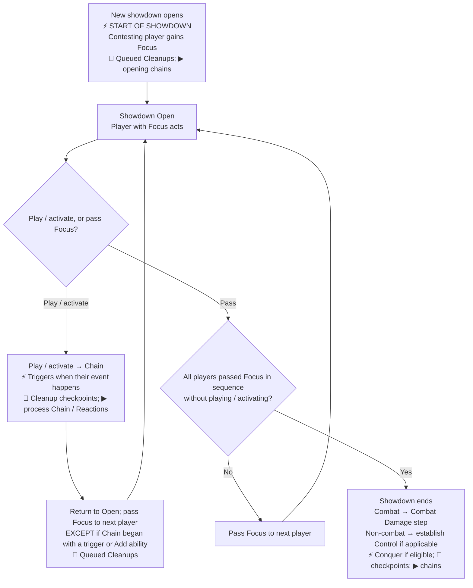

# Showdown Flowchart

[[General Index|General index]] · [[Core Rules Index#Chains, showdowns, and cleanups|Chains, showdowns, and cleanups]] · [[Combat Flowchart|Related flowchart]]

This loop is shared by combat and non-combat showdowns. Combat enters at Showdown Open after processing its opening tasks and chains; see [[Combat Flowchart#Combat sequence|the complete combat sequence]].

**⚡** marks a satisfied trigger condition: the ability becomes Pending. **▶** marks chain processing after outstanding Tasks are handled. **🧹** marks queued Cleanup checkpoints; the **Combat Special Cleanup** is highlighted separately.

## Showdown loop

If Cleanup converts a non-combat showdown into combat, continue at [[Combat Flowchart#Combat sequence|Combat Step 1]] with the current Focus. Start-of-combat effects occur; start-of-showdown effects do not repeat.

Open Showdown play requires [[Action (Keyword)|Action]], [[Reaction (Keyword)|Reaction]], or another permission. During a Closed Chain, players use Priority for Reactions. See [[Combat Flowchart#Keyword timing side notes|keyword timing side notes]] for Ambush, Quick-Draw, and Deflect.

## Read the full rules

- [[Showdowns]]
- [[Chains and Showdowns]]
- [[Focus]]
- [[Priority and Focus]]
- [[Cleanups]]
- [[Chain]]
- [[Conquer]]
- [[Action (Keyword)]]
- [[Reaction (Keyword)]]

This chart is a reading aid. The linked rule notes contain the full conditions, exceptions, and procedures.

## Source references

ⓘ

Core rules 319, 320, 323.11, 323.13, 334, 340, 344, 345, 346, 347, 348, 466.2.c.1, 471, 806, 813; PDF pages 40, 41, 42, 43, 44, 45, 46, 101, 105, 126, 131

