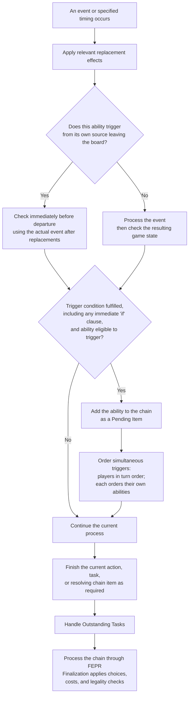

# Trigger Timing Flowchart

[[General Index|General index]] · [[Core Rules Index#Abilities and effects|Abilities and effects]] · [[Turn Phases Flowchart|Related flowchart]]

**Event triggers can happen in any phase**, including during readying, holding, channeling, drawing, or cleanup. A satisfied condition places the ability on the chain as a Pending Item; its effect is processed through the chain. See [[Turn Phases Flowchart]] to locate the turn phases.

**Ability finalization:** [[Playing or Activating Abilities Flowchart]].

**Showdown and combat:** [[Combat Flowchart#Combat sequence|Combat trigger sequence]] · [[Showdown Flowchart#Showdown loop|Showdown loop]] · [[Combat Flowchart#Keyword timing side notes|Keyword timing]].

## Trigger condition check

## Read the full rules

- [[Triggered Ability]]
- [[Replacement Effect]]
- [[Chain]]
- [[Pending Chain Item]]
- [[Handling Tasks and Resolving Chain Items]]
- [[HOT FEPR]]
- [[Cleanups]]

This chart is a reading aid. The linked rule notes contain the full conditions, exceptions, and procedures.

## Source references

ⓘ

Core rules 367, 383.2.a.1, 383.2.c, 383.3, 383.3.d, 334, 337, 340; PDF pages 43, 44, 62, 67, 68, 69

