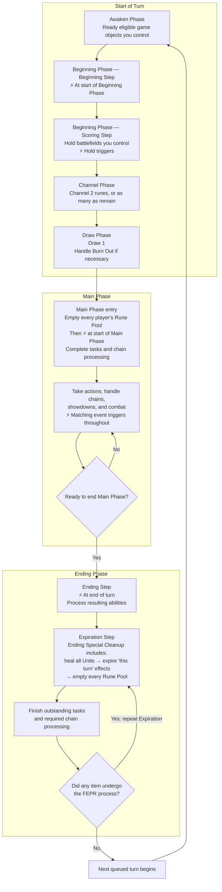

# Turn Phases Flowchart

[[General Index|General index]] · [[Core Rules Index#Turns and timing|Turns and timing]] · [[Trigger Timing Flowchart|Related flowchart]]

This chart shows the default turn. Finish the current phase or step's outstanding tasks and required chain processing before advancing. Card effects and game-mode rules can modify the default turn.

**⚡ marks when a trigger condition can become satisfied.** See [[Trigger Timing Flowchart]] for how those conditions are checked and processed.

## Turn sequence

**Before the first turn:** [[Game Setup Flowchart#Game setup sequence|Set up the game and check mode-specific first-turn changes]].

**Beginning Step abilities are processed before holding.** The **Expiration Step** can repeat without repeating the **Ending Step**.

## Read the full rules

- [[Start of Turn]]
- [[Main Phase]]
- [[Ending Phase]]
- [[Turn Phases]]
- [[Beginning Step]]
- [[Scoring Step]]
- [[Ending Step]]
- [[Expiration Step]]
- [[Handling Tasks and Resolving Chain Items]]
- [[HOT FEPR]]
- [[Cleanups]]

This chart is a reading aid. The linked rule notes contain the full conditions, exceptions, and procedures.

## Source references

ⓘ

Core rules 315, 316, 317, 334, 335; PDF pages 37, 38, 40, 43

